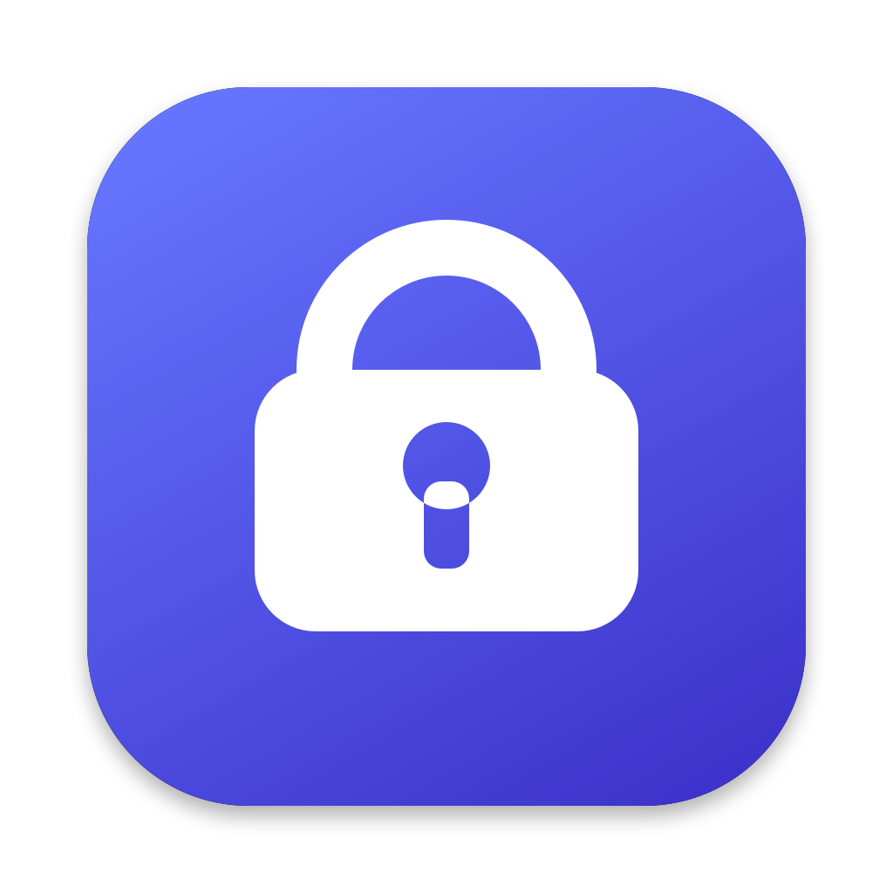

<p align="center">
  
</p>

<h1 align="center">VaultBar</h1>

<p align="center">
  A native macOS menu bar app for your Bitwarden-compatible password vault: search, copy, and
  live TOTP codes one click (or one hotkey) away, without opening a browser.
</p>

<p align="center">
  
</p>

> The screenshots use a built-in demo vault with invented data. VaultBar is an independent
> project and is not affiliated with or endorsed by Bitwarden.

## Features

The layout follows the browser extension: **Vault**, **Generator**, **2FA** and **Settings** tabs.
Everything, including first-run login and all settings, lives in the popover: no extra windows.

- **Vault**: fuzzy search, folder / type / organization filters, favorites, per-item copy and a
  ⋮ menu with **copy, edit, clone and delete** (delete moves to the trash, with a confirmation).
  **Add** creates logins, cards, identities and notes, including custom fields and an
  authenticator key. Edits are merged into the item's original JSON, so password history,
  attachments and passkeys survive.
- **2FA**: every item with an authenticator key, with live codes computed locally (RFC 6238,
  tested against the RFC vectors): base32 secrets, `otpauth://` URIs (SHA1/256/512, 6 or 8
  digits, any period) and `steam://` keys. Countdown ring, next code previewed in the last 5 s.
  Works on the free plan; the key is your own data.
- **Generator**: passwords (length 5-128, character sets, minimum numbers/symbols, avoid
  ambiguous) and passphrases (EFF large wordlist), generated locally with the system CSPRNG.
  Options persist; generated values never do.
- **Bitwarden cloud (US and EU), self-hosted Bitwarden and Vaultwarden.**
- **Touch ID unlock** after the first master-password unlock; auto-lock on idle, sleep, screen
  lock and fast user switching.
- **Clipboard hygiene**: copies are marked concealed/transient so clipboard managers skip them,
  and cleared after a delay (only if the clipboard still holds the copied value).
- **Settings tab**: Touch ID, auto-lock, clipboard timeout, global hotkey recorder, start at login,
  website icons, organization items, language and log out.
- Item detail with hidden-field masking, English and Bahasa Indonesia, light and dark.

Keyboard: global hotkey (default `⌃⌥⌘V`), `↑↓` select, `↩` copy password (code in 2FA, value in
Generator), `⌘C` username, `⌘T` code, `→`/`←` open/close detail, `⌘N` new item, `⌘E` edit,
`⌘S` save, `⌘R` regenerate, `⌘1`-`⌘4` tabs, `⌘L` lock, `Esc` back/close.

Not included: autofill into browsers or other apps, attachments, Sends, vault health, organization
and collection management.

## Requirements

- macOS 14 or later
- The official Bitwarden command line tool: `brew install bitwarden-cli`

VaultBar never implements the vault crypto itself. Login (including 2FA and new-device checks),
key derivation and decryption all stay in Bitwarden's own audited CLI; VaultBar reads the
decrypted items from a local `bw serve` it manages.

## Install

```sh
brew install --cask ahmadarif-lab/tap/vaultbar
```

Or download `VaultBar.dmg` from Releases. The app is ad-hoc signed, not notarized, so on a manual
install right-click → Open the first time (the Homebrew cask clears the quarantine flag for you).

## Build from source

```sh
swift test                      # unit + integration tests (uses a fake `bw`)
./Scripts/run_dev.sh --demo     # run with the fake demo vault
./Scripts/package_release.sh    # dist/VaultBar.app + dist/VaultBar.dmg + sha256
```

`--snapshot-dir <dir>` renders the README screenshots from the demo vault.

## How it works

```
VaultBar ── spawns ──▶ bw serve --hostname 127.0.0.1 --port <random>   (only while unlocked)
   │                         ▲
   └── REST (localhost) ─────┘   /list/object/*, /object/item (create, update, delete), /sync, /lock
```

- VaultBar keeps its own `bw` state in `~/Library/Application Support/VaultBar/bw`, so it never
  touches a `bw` login you may already have.
- The master password reaches `bw` only through the child's environment (`--passwordenv`), never
  argv, where `ps` would show it. The session key is held in memory and handed to `bw serve`
  through its environment.
- Lock = `bw lock` + stop `bw serve` + drop all decrypted items from memory.
- TOTP is computed in the app from the decrypted `login.totp`; `bw get totp` is never used.

## Security and threat model

**What it protects against**

- Secrets on disk: nothing secret is written to UserDefaults, logs, crash reports or temp files.
  The only persisted state is non-secret preferences and `bw`'s own encrypted data file.
- Shoulder-surfing the clipboard history: concealed + transient pasteboard types, auto-clear.
- A locked app means a locked vault: while locked there is no `bw serve`, no session key and no
  decrypted item in memory.
- Network exposure: `bw serve` listens on 127.0.0.1 only, on a random port, and is killed on
  lock, on quit, and (via a pid file) on the next launch after a crash.
- Favicons are off by default; when enabled, only the domain is sent, to your own vault server's
  icon service, and icons are cached in memory only.

**What it does not protect against**

- Malware running as your user. While the vault is unlocked, `bw serve` has no authentication,
  so any process of yours that finds the port can read the vault. Locking closes that window.
- A compromised `bw` binary or a hostile `PATH` entry that shadows it.
- Memory inspection by a privileged attacker while unlocked.
- Hardware keyloggers / screen capture while you type the master password.

**Touch ID**: the master password (not a session key) sits behind Touch ID. The strongest option
is a Keychain item with `.biometryCurrentSet` access control, but macOS only allows that for apps
signed with Keychain entitlements (an ad-hoc signed app gets `errSecMissingEntitlement`). VaultBar
therefore tries it first and otherwise falls back to a this-device-only Keychain item that is read
only after a Touch ID prompt inside the app, and is discarded if your enrolled fingerprints change.
The fallback is weaker: the Keychain's per-app access list protects the item, not the biometric
hardware. If that matters to you, leave Touch ID off; every unlock then asks for the master password.

The app runs with the hardened runtime. The App Sandbox is off because the app has to spawn `bw`.

## License

MIT
