<p align="center">
  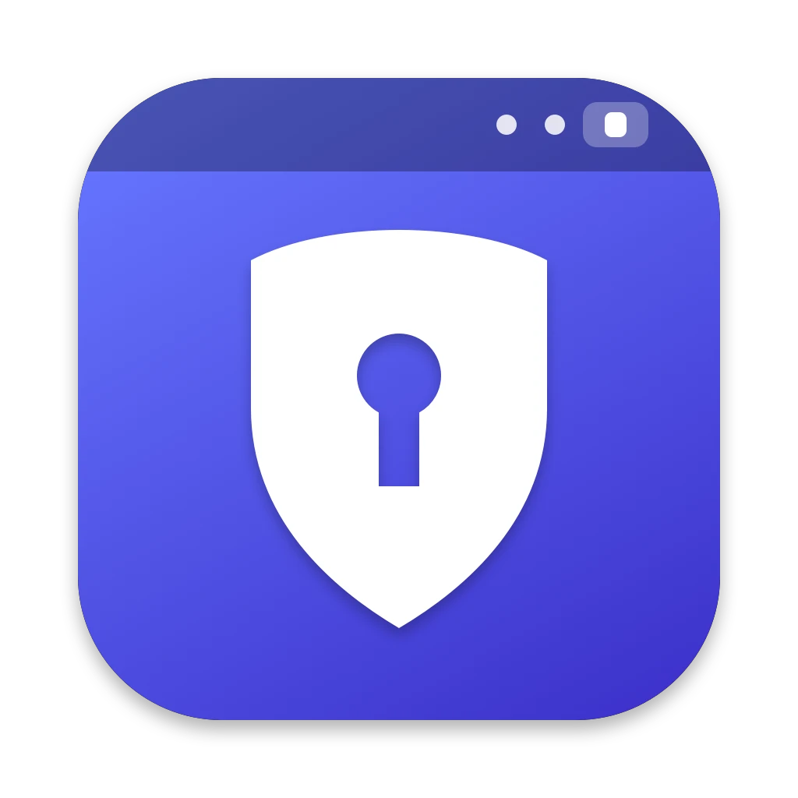
</p>

<h1 align="center">VaultBar</h1>

<p align="center">
  A native macOS menu bar app for your Bitwarden-compatible password vault: search, copy and
  live 2FA codes one click (or one hotkey) away, without opening a browser.<br>
  It speaks the Bitwarden API directly, so there is <strong>no <code>bw</code> CLI and no Node</strong> to install.
</p>

<p align="center">
  <a href="#install">
    
  </a>
  <a href="https://github.com/ahmadarif-lab/vaultbar/releases/latest">
    
  </a>
  
  
</p>

<p align="center">
  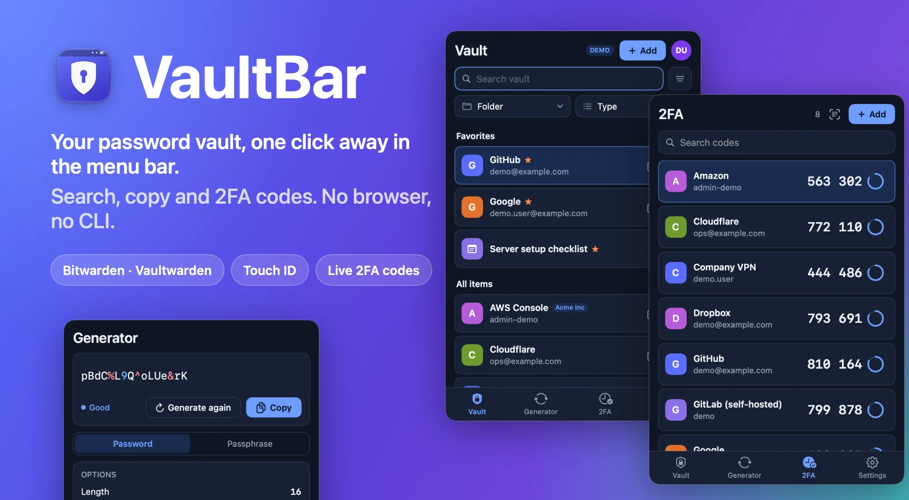
</p>

> The screenshots use a built-in demo vault with invented data. VaultBar is an independent
> project and is not affiliated with or endorsed by Bitwarden.

## Features

The layout follows the browser extension: **Vault**, **Generator**, **2FA** and **Settings** tabs.
Everything, including first-run login and all settings, lives in the popover: no extra windows.
Light or dark follows macOS by default, or pick one in Settings.

- **Vault**: fuzzy search (name, username, website, folder), folder / type / organization filters,
  favorites, and per-item **copy** (a small menu offers username, password or code when there is a
  choice) plus a ⋮ menu with **view, edit, clone, delete and open**. Delete moves to the trash,
  with a confirmation. **Add** creates logins, cards, identities and notes, including custom fields
  and an authenticator key. Edits keep password history, passkeys and per-item keys intact.
- **2FA**: every item with an authenticator key, with live codes computed locally (RFC 6238,
  tested against the RFC vectors): base32 secrets, `otpauth://` URIs (SHA1/256/512, 6 or 8
  digits, any period) and `steam://` keys. Countdown ring; click to copy. Works on the free plan;
  the key is your own data.
- **Scan a setup QR code**: when a site shows a QR code to register 2FA, read it from the screen
  (drag a box around it), from an image file, or from a screenshot on the clipboard. The key, name
  and username are filled in for you. Google Authenticator's bulk export code is not supported.
- **Generator**: passwords (length 5-128, character sets, minimum numbers/symbols, avoid
  ambiguous) and passphrases (EFF large wordlist), generated locally with the system CSPRNG.
  Options persist; generated values never do.
- **Folders**: add, rename and delete folders from Settings.
- **Bitwarden cloud (US and EU), self-hosted Bitwarden and Vaultwarden**, multiple accounts.
- **Touch ID unlock** after the first master-password unlock. Auto-lock on idle, sleep, screen
  lock and fast user switching, plus an optional **lock when closed** that locks the moment the
  popover closes.
- **Clipboard hygiene**: copies are marked concealed/transient so clipboard managers skip them,
  and cleared after a delay (only if the clipboard still holds the copied value). The popover
  stays open after a copy unless you turn on *Close after copying*.
- **Import / export**: Bitwarden `.json` (unencrypted) both ways, so you can move a vault in from the
  browser extension or take a backup out. Import skips items already in the vault (running it twice is
  harmless), keeps folders and password history, and reports what it skipped. Export asks for the master
  password first. Passkeys are not carried over; encrypted/CSV exports are not supported yet.
- **Settings**: theme (System, Light or Dark), Touch ID, auto-lock, lock when closed, clipboard timeout, global hotkey recorder,
  start at login, close after copying, website icons, organization items, language, import/export,
  and **About** with the version, the server version and *Check for updates*.
- Item detail with hidden-field masking, English and Bahasa Indonesia, light and dark.

Keyboard: global hotkey (default `⌃⌥⌘V`), `↑↓` select, `↩` copy password (code in 2FA, value in
Generator), `⌘C` username, `⌘T` code, `→`/`←` open/close detail, `⌘N` new item, `⌘E` edit,
`⌘S` save, `⌘R` regenerate, `⌘1`-`⌘4` tabs, `⌘L` lock, `Esc` back/close.

Not included: autofill into browsers or other apps, attachments, Sends, vault health, organization
and collection management, passkeys.

<details>
<summary><strong>More screenshots</strong></summary>

<p align="center">
  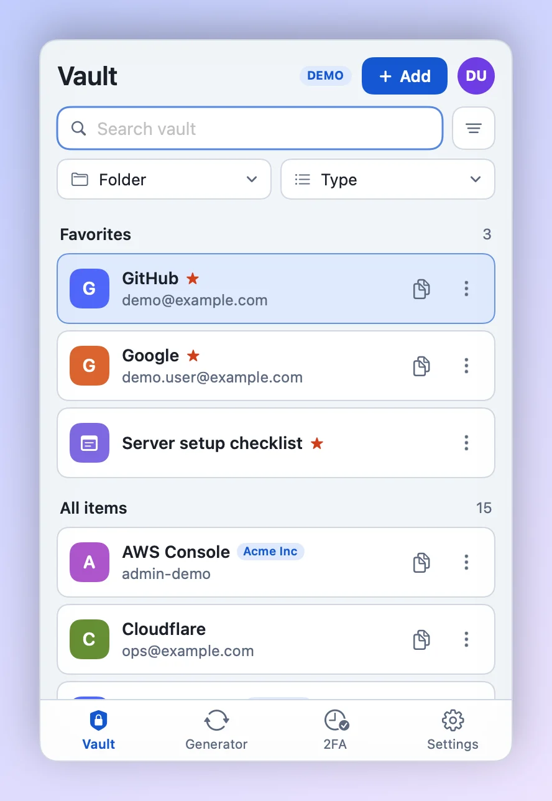
  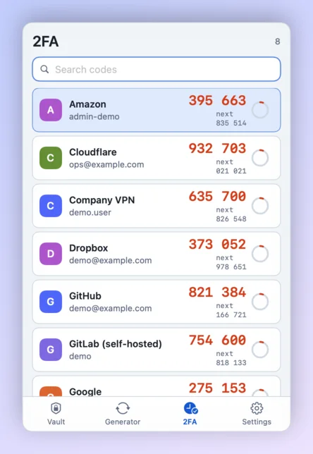
  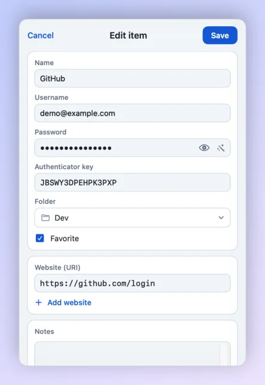
</p>
<p align="center">
  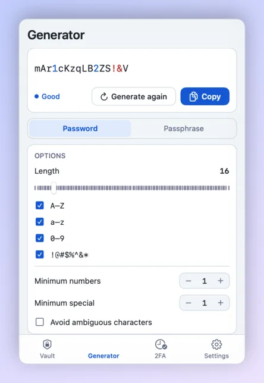
  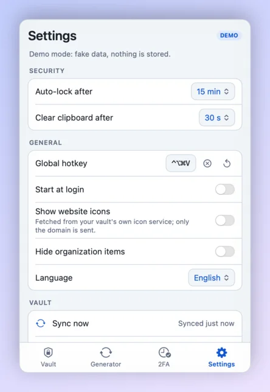
  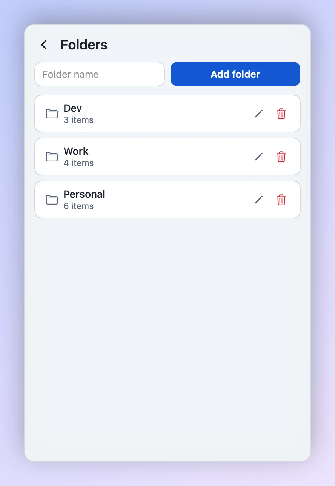
</p>
<p align="center">
  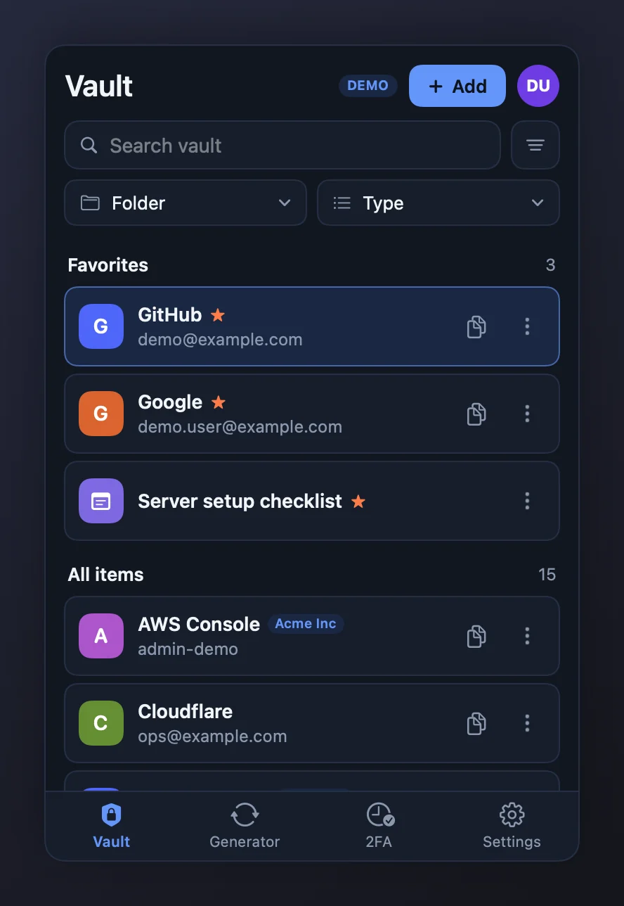
  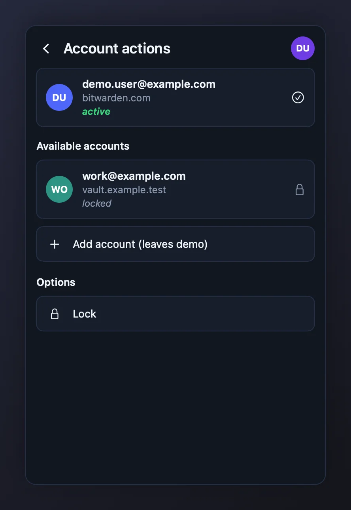
  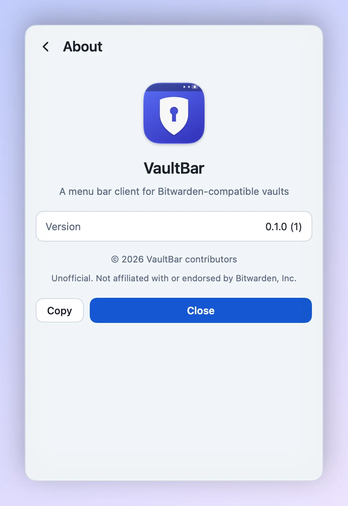
</p>

</details>

## Install

```sh
brew install --cask ahmadarif-lab/tap/vaultbar
```

Or download `VaultBar.dmg` from Releases. The app is ad-hoc signed, not notarized, so on a manual
install right-click → Open the first time (the Homebrew cask clears the quarantine flag for you).

## Logging in

Enter your e-mail and press Continue (like the extension), then the master password. The server is
chosen at the bottom ("Accessing: bitwarden.com"): bitwarden.com, bitwarden.eu or your own server
(Bitwarden self-hosted, Vaultwarden). If the server wants a second step, a verification screen asks for
the authenticator, e-mail or YubiKey code (or the new-device code Bitwarden e-mails you).

- **Vaultwarden / self-hosted**: tested end to end (login, 2FA, sync, create, edit, clone, delete,
  Argon2id and PBKDF2 accounts, API key, offline unlock).
- **bitwarden.com / .eu**: the protocol is the same, but the cloud challenges unofficial clients
  more often (captcha). If you hit that, tick *Log in with an API key* (web vault → Account
  settings → Security → Keys); the master password is still needed to decrypt the vault.
- Passkey, Duo and security-key (WebAuthn/U2F) second factors can't be completed here; use an
  authenticator app or the API key instead.

## Build from source

```sh
swift test                      # unit tests (crypto vectors, generator, TOTP, QR, decryptor…)
./Scripts/run_dev.sh --demo     # run with the fake demo vault
./Scripts/package_release.sh    # dist/VaultBar.app + dist/VaultBar.dmg + sha256
./Scripts/screenshots.sh        # regenerate the README images from the demo vault (needs cwebp)
```

Builds are ad-hoc signed, which makes macOS ask for the login keychain password again after every
rebuild. For local work set `SIGN_IDENTITY` to a certificate from `security find-identity -v -p codesigning`
(for example `SIGN_IDENTITY="Apple Development: Your Name (TEAMID)" ./Scripts/package_release.sh`) and the
prompt appears only once.

End-to-end tests against a real Vaultwarden (needs a server you can throw away):

```sh
docker run -d --name vw -p 127.0.0.1:18222:80 -e SIGNUPS_ALLOWED=true -e DOMAIN=http://localhost:18222 \
  -e I_REALLY_WANT_VOLATILE_STORAGE=true -e LOGIN_RATELIMIT_MAX_BURST=1000 -e LOGIN_RATELIMIT_SECONDS=1 vaultwarden/server
VW_URL=http://127.0.0.1:18222 swift test -c release --filter NativeE2ETests
```

`--demo` runs a fake vault, `--selftest` drives the app's own state machine in demo mode, and
`--snapshot-dir <dir>` renders the README screenshots from the demo vault. These three modes use a
separate, throwaway preferences store, so they never touch your real settings.

## How it works

- **Keys**: the master key comes from PBKDF2-SHA256 or Argon2id (RFC 9106, implemented here and
  checked against the RFC test vectors), stretched with HKDF into an AES-256 + HMAC-SHA256 key
  pair that unwraps your vault key. Items are AES-256-CBC with an HMAC checked before decrypting.
  Organization items unwrap their keys with RSA-OAEP. Only Apple's CommonCrypto, CryptoKit and
  Security frameworks are used for the primitives.
- **Writes** merge your edits into the item's decrypted JSON, encrypt each field, and send only the
  fields the server's cipher API accepts (the legacy `data` blob the cloud returns is never sent
  back, or the cloud would keep the old values). After every save the item is read back from the
  server, and a banner names any field the server did not apply. Delete moves to the trash.
- **Storage**: per account, `~/Library/Application Support/VaultBar/accounts/<id>/` holds the
  encrypted vault cache (ciphertext only, mode 0600) and the key as the server stores it, so
  unlocking works offline. The refresh token is in the Keychain.
- TOTP is computed in the app from the decrypted `login.totp`. A QR code is decoded on this Mac
  (Vision framework); a screen capture lives in a temp file only until it has been read.
- **Updates**: *Check for updates* makes one anonymous request to GitHub's releases API. Nothing
  about you or your vault is sent, and nothing is installed automatically.

## Security and threat model

**What it protects against**

- Secrets on disk: nothing secret is written to UserDefaults, logs or temp files. On disk there is
  only ciphertext (the vault cache and the wrapped key, exactly what the official clients cache)
  and non-secret preferences. The master password and the decrypted vault key exist only in memory
  while unlocked.
- Wrong or tampered data: every item's HMAC is verified before decryption; a bad item is skipped
  instead of failing the whole vault.
- A locked app means a locked vault: locking drops the keys, the access token and all decrypted
  items from memory.
- Clipboard history: copies are marked concealed/transient and auto-cleared.
- No local server: unlike a `bw serve` setup, no port is opened on your machine.
- KDF parameters from the server are range-checked before use (a hostile server can't ask for
  gigabytes of Argon2 memory).
- Favicons are off by default; when enabled, only the domain is sent, to your own vault server's
  icon service, and icons are cached in memory only.

**What it does not protect against**

- Malware running as your user or a privileged attacker who can read this process's memory while
  the vault is unlocked. Swift strings can't be reliably zeroed, so the master password may
  linger in freed memory after unlocking.
- Hardware keyloggers / screen capture while you type the master password.
- A server you don't trust: it holds your encrypted vault (that is true of any Bitwarden client).

**Touch ID**: the master password (not a session key) sits behind Touch ID. The strongest option
is a Keychain item with `.biometryCurrentSet` access control, but macOS only allows that for apps
signed with Keychain entitlements (an ad-hoc signed app gets `errSecMissingEntitlement`). VaultBar
therefore tries it first and otherwise falls back to a this-device-only Keychain item that is read
only after a Touch ID prompt inside the app, and is discarded if your enrolled fingerprints change.
The fallback is weaker: the Keychain's per-app access list protects the item, not the biometric
hardware. If that matters to you, leave Touch ID off; every unlock then asks for the master password.

The app runs with the hardened runtime and needs no sandbox exceptions beyond network access.

VaultBar is an independent project and is not affiliated with or endorsed by Bitwarden.
Using the API directly is how every third-party client works, but it is not an officially
supported client: the server may change behavior, and the cloud may challenge logins.

## License

MIT
